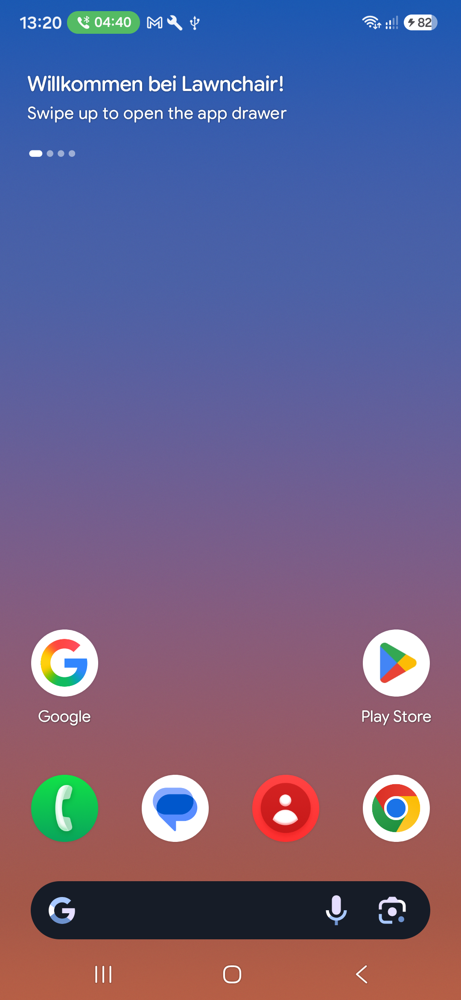
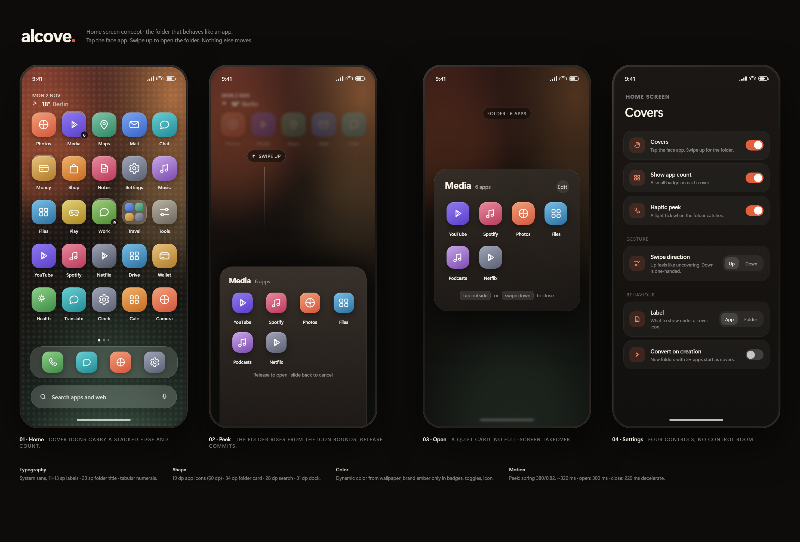
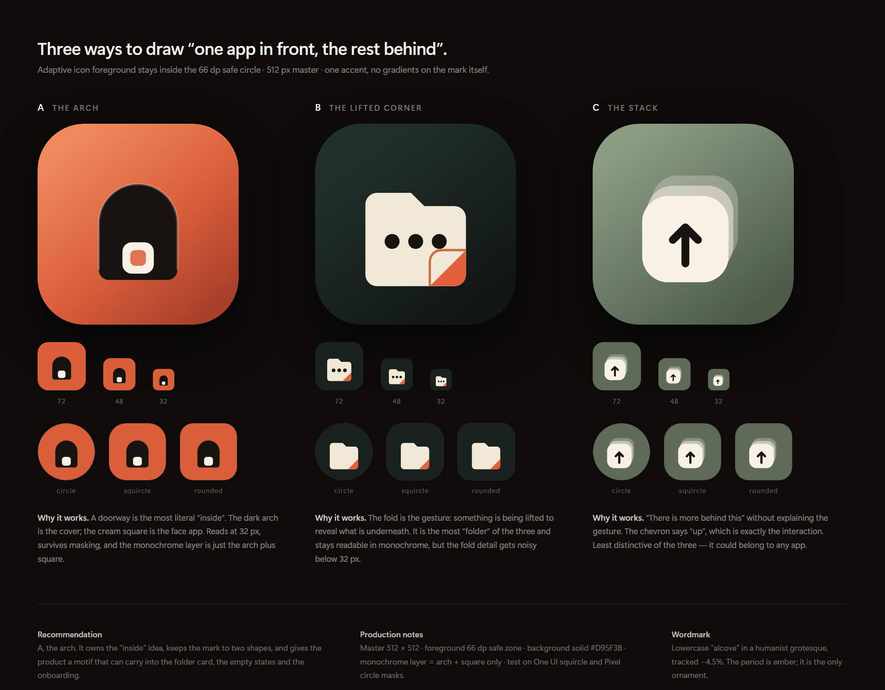

# Alcove

A downstream fork of **Lawnchair 16** (`16-dev`) that always tracks the newest working upstream,
and carries **folder cover mode** until Lawnchair ships it itself.
Fork: <https://github.com/L3v1a7h4N/lawnchair> · upstream:
<https://github.com/LawnchairLauncher/lawnchair>.

Cover mode is the interaction this project is about: a folder shows its first app as its icon,
tapping launches that app, swiping up opens the folder. It is implemented by
[Lawnchair PR #7213](https://github.com/LawnchairLauncher/lawnchair/pull/7213) — this fork merges
that PR rather than maintaining a second implementation.



*The Google folder after enabling cover mode: the folder's first app (Google) is now the icon.
Tap launched Google Search; swipe up opened the folder with Gmail, YouTube and Drive.*

## Status

| Item | State |
|---|---|
| Base | `LawnchairLauncher/lawnchair@16-dev`, merged 4 Nov 2026 |
| Cover mode | PR #7213 merged into `main` (11 commits, 12 files) |
| Build | `BUILD SUCCESSFUL`, 6m 20s, 49 MB debug APK |
| Device test | S741B (Android 17 / API 37): popup toggle, tap-to-launch, swipe-to-open verified |
| Docs | Research, plan, design, ADRs, upstream policy, build notes |
| Not done yet | Alcove branding/icon, stack-edge affordance, count badge, peek preview, onboarding |

## How updates work

`main` is `upstream/16-dev` plus the Alcove docs and the cover-mode merge. One script keeps it
current and only keeps the result if it builds:

```powershell
# fetch newest 16-dev, merge PR #7213 if cover mode is still missing, build, install
.\scripts\sync-upstream.ps1 -Install -Device RZGL81FQYEN
```

What it does:

1. Fetches `upstream/16-dev` and the PR head.
2. Merges `16-dev` into `main`.
3. Checks whether upstream already contains cover mode (`FLAG_COVER` / `FolderCoverMode`). If not,
   merges PR #7213; if yes, skips it automatically.
4. Builds `assembleLawnWithQuickstepGithubDebug`.
5. On success: tags `alcove-last-good`, optionally installs.
6. On failure: rolls `main` back to the commit it started from. A completed merge that fails to
   build is kept as an `alcove-failed-*` branch; a conflicted merge is aborted.

Details, conflict handling and the "PR got merged upstream" path: [docs/UPSTREAM.md](docs/UPSTREAM.md).
When Lawnchair opens `17-dev`, pass `-UpstreamBranch 17-dev`; the cover detection and PR logic are
branch-agnostic.

## Build

```powershell
$env:JAVA_HOME = "C:\Program Files\Eclipse Adoptium\jdk-25.0.3.9-hotspot"
$env:ANDROID_HOME = "$env:LOCALAPPDATA\Android\Sdk"
.\scripts\build.ps1 -Install -Device RZGL81FQYEN -Launch
```

Or directly:

```powershell
.\gradlew.bat assembleLawnWithQuickstepGithubDebug
```

Requires JDK 21+, Android SDK platform **37.2**, build-tools **37.0.0**, and a
`local.properties` with `sdk.dir`. The APK is
`build\outputs\apk\lawnWithQuickstepGithub\debug\Lawnchair.16.Dev.(<sha>).github.debug.apk`.

See [docs/BUILD.md](docs/BUILD.md) for the SDK 37.2 workaround and the host-specific JDK note.

## Why this fork exists

Nova called the interaction *Swipe to open folder*; Action Launcher called it *Covers*. Both apps
are effectively discontinued, and Lawnchair's request for it has been open since 2022
([#2659](https://github.com/LawnchairLauncher/lawnchair/issues/2659)). PR #7213 finally implements
it. The fork gives us a daily driver with it today, while staying one merge away from upstream.

The longer-term product idea — name, arch icon, stack-edge affordance, count badge, peek animation
and onboarding — is in [docs/DESIGN.md](docs/DESIGN.md) and
[docs/COVERS-SPEC.md](docs/COVERS-SPEC.md). Those are enhancements on top of the PR, not a
replacement for it.

## Documents

| Document | Contents |
|---|---|
| [docs/UPSTREAM.md](docs/UPSTREAM.md) | Branch model, sync/rollback, cover detection, PR lifecycle, conflicts |
| [docs/PLAN.md](docs/PLAN.md) | Phases, what the PR already covers, remaining work, test matrix, risks |
| [docs/RESEARCH.md](docs/RESEARCH.md) | Fork comparison, Launcher3 internals, platform/One UI constraints, build findings |
| [docs/DESIGN.md](docs/DESIGN.md) | Naming, icon concepts, cover interaction spec, gesture arbitration, visual language |
| [docs/COVERS-SPEC.md](docs/COVERS-SPEC.md) | Implementation notes (superseded by the PR) plus the enhancement backlog |
| [docs/DECISIONS.md](docs/DECISIONS.md) | ADRs, including the decision to carry PR #7213 |
| [docs/BUILD.md](docs/BUILD.md) | Toolchain, SDK 37.2 install, commands, verified results |

## Design

| UI concepts | Icon concepts |
|---|---|
|  |  |

Rendered from [design/mockups.html](design/mockups.html) and [design/icons.html](design/icons.html).

## Devices

| Device | Model | Android | API |
|---|---|---|---|
| Galaxy A54 | SM-A546B | 16 | 36 |
| Galaxy S (2026 FE) | SM-S741B | 17 | 37 |

Both are 1080 × 2340 at 420 dpi effective (411 × 891 dp). The S741B is the primary target and
currently runs Action Launcher as its home app.

## Licence

Apache-2.0, inherited from AOSP Launcher3 and Lawnchair. Upstream `LICENSE.txt` and `NOTICE`
files are kept; Alcove contributions are under the same licence.
