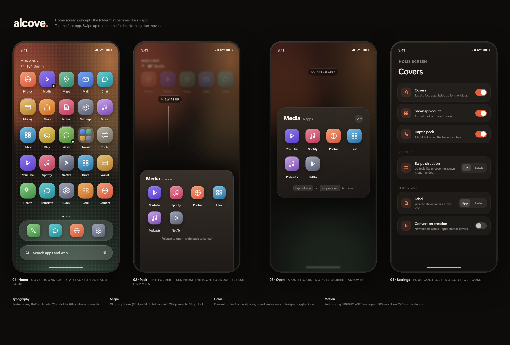
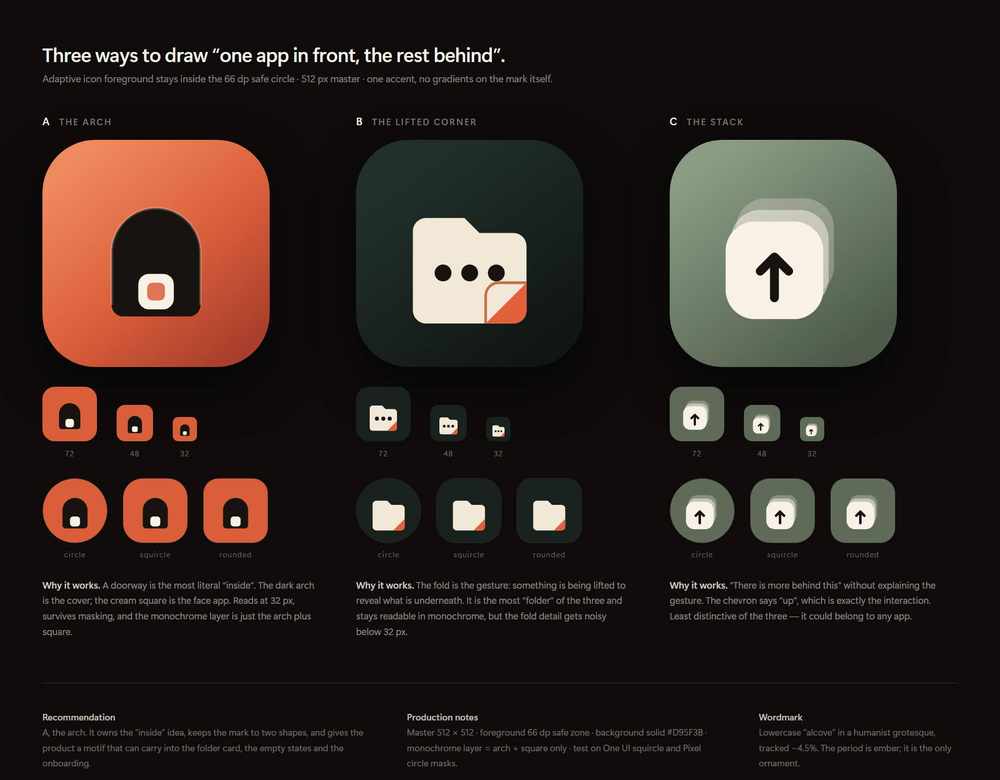

# Design: name, mark, and the Covers interaction

Status: concept v1, 2 November 2026. Mockups and icon sheets are rendered from
`design/mockups.html` and `design/icons.html`.

## 1. Naming

### What the name has to do

- Say **home**, not **utility**. A launcher is furniture; the name should feel like a place.
- Survive being said in German and English (the first users are in Berlin; the store listing
  will be bilingual).
- Not collide with a launcher, an icon pack, or a well-funded productivity app.
- Leave room for the feature to be named separately. The launcher is the product; **Covers** is
  the interaction.

### Shortlist

| Name | Why | Risk | Verdict |
|---|---|---|---|
| **Alcove** | An architectural recess — a sheltered space in a wall where things are kept, half-hidden behind the surface. Exactly the cover-folder idea. German *Alkoven* exists, so it is pronounceable and evocative locally. Calm, premium, not another "-launcher". | A few small apps use it (Alcove tasks/notes on iOS, Alcove Connect on Play, Reserve ALCOVE). None is a launcher; class-9 trademark needs a check. | **Recommended working name** |
| **Cove** | Shorter, warmer, same water/shelter imagery. Good wordmark. | Crowded: Cove workspace app, Cove smart-home/security, Cove buildings. Harder to own. | Fallback |
| **Tuck** | A verb: tuck apps away. Playful, memorable, describes the gesture. | Reads casual; a bedding brand owns "Tuck"; may undercut a premium UI. | Wildcard |
| **Latch** | The thing that opens the cover. | Latch is a smart-lock company (acquired by Door.com); direct trademark conflict. | Reject |
| **Nook** | Perfect meaning (a sheltered corner). | Barnes & Noble Nook, strongly registered. | Reject |
| **Shade** | A cover, and a calm surface. | Shade Launcher already exists in the open-source Android world. | Reject |

### Recommendation

Work as **Alcove**. Tagline: **"One icon. All your apps."** Second line for the store:
"The folder that behaves like an app. Tap for the one you use, swipe for the rest."

Before spending on brand assets, do three cheap checks: Play Store search for "Alcove" in the
launcher category, DPMA/EUIPO class 9 + 42 search, and `alcove.app` / `alcove.dev` domain/DNS
availability. If any blocks, **Cove** is the fallback with the same mark concept.

The package id should not depend on the name: use `app.alcove.home` and keep the launcher
component name in one `resValue`, as Lawnchair does, so a rename is a build-config change.

## 2. Icon

Three directions, all built from two shapes:

- **A · The arch (recommended).** A doorway cut into a warm ember squircle; a cream app tile sits
  inside. It is the only mark that says "inside" rather than "more" or "folder". It survives
  masking because the arch is centred, and the monochrome layer is just arch + tile.
- **B · The lifted corner.** A cream folder with one corner peeled up. Most literally a folder,
  and the fold is the gesture — but the fold turns to mush below 32 px.
- **C · The stack.** Three offset tiles and an up chevron. Clear at every size, but generic; it
  could be a file manager or a cloud drive.

Production spec for A:

| Property | Value |
|---|---|
| Master | 512 × 512, exported at 512/192/96/72/48/32 |
| Adaptive icon | background `#D95F3B`; foreground = arch + tile, inside 66 dp safe circle |
| Monochrome | arch silhouette + tile, single colour, no gradient |
| Mask tests | One UI squircle, Pixel circle, rounded square |
| Contrast | cream `#F7F1E6` on ember `#D95F3B` = 3.1:1 for the tile; arch is `#17130F` at 8.9:1 |
| Wordmark | lowercase `alcove`, humanist grotesque, tracking −4.5%, ember period |

The arch is more than an icon: it becomes the folder card's top edge, the empty-state illustration
and the onboarding motif. That is the test of a real mark — it can be reduced to a line and still
be recognised.

## 3. The Covers interaction

**One sentence:** a cover is a folder that wears its first app as its face — tap launches that
app, swipe up opens the folder.

### Rules

1. **Face = first app.** The first item in folder order is the face. Reordering the folder (or
   "Set as cover" in the context menu) changes the face. No separate cover slot to maintain.
2. **Tap = launch face.** Exactly the app shown. The icon never lies.
3. **Swipe up = open folder.** Scope: the touch must start inside the icon's 60 dp bounds. A
   vertical drag of 24 dp (or 12 dp plus 800 dp/s velocity) arms the peek; releasing past 48 dp
   opens. Releasing earlier springs back.
4. **Long-press = menu.** *Open folder*, *Change cover app*, *Folder settings*, *Remove*. Long
   press never opens the folder; that is what the tap does now.
5. **Drag = move the folder.** Dragging the icon moves the whole folder, unchanged from Launcher3.
   Dropping an app onto it adds to the folder; the drop target highlight uses the 2×2 preview,
   not the single face, so the "this is a container" signal is explicit.
6. **Badges aggregate.** The folder dot shows the sum of its children's notifications, as today.
   The face app's own dot is included.
7. **Minimum two apps.** A one-app folder is not a folder. If a cover drops to one child, it
   reverts to a normal folder icon and offers "Keep as icon?" in a snackbar.
8. **Empty folder** is removed, as Launcher3 already does.
9. **Work profile / archived apps** are treated like any child; an archived face app shows the
   cloud badge and tapping it opens the system's restore flow.
10. **Search and folder semantics are unchanged.** A cover is still a folder in the database, in
    search, in backup, and to the system.

### Gesture arbitration (the part that usually goes wrong)

| Competing gesture | How we resolve it |
|---|---|
| Horizontal page swipe | Only arm on `|dy| > |dx|` after touch slop. Horizontal wins early. |
| Swipe up for app drawer | The icon consumes the gesture because it starts inside the icon; the workspace only sees gestures that begin elsewhere. |
| Long-press drag | If long-press fires before the vertical threshold, cancel the peek and start the drag. Never both. |
| Folder drag-out | While a folder is open, dragging an app out is `Folder`'s gesture; the cover icon is behind the scrim. |
| System back gesture | Edge swipes are outside the icon bounds; no interaction. |
| Samsung gesture nav | The system owns the bottom 16 dp; the icon is never there. |

The gesture should be **directional, not positional**: it is the direction of travel that opens
the folder, so it works with either hand and with the phone upside down.

### States

| State | Visual | Haptic |
|---|---|---|
| Rest | face icon + 2 px stacked card edge + optional count badge | — |
| Pressed | scale 0.94, 90 ms | light |
| Armed (24 dp) | card edge separates, folder card peeks 12 dp from the icon's bottom | tick |
| Peeking (24–48 dp) | folder card follows the finger, scrim fades in at 40% | — |
| Commit (>48 dp) | card springs to centre, scrim 56%, folder grid staggers in | confirm |
| Cancel | card returns to icon, scrim out, 220 ms | — |

### Discoverability

A gesture with no affordance is a hidden feature. Three layers:

1. **Static:** the stacked edge and the count badge say "there is more here". A 2 px edge is
   enough once you know; the badge does the work for everyone else.
2. **First creation:** a one-time anchored tooltip on the new cover — "Swipe up to see all 6
   apps" — dismissed by the gesture or by tapping elsewhere. Never shown twice.
3. **Settings:** *Home screen → Covers* explains the gesture with a looping 3-second demo, and
   lets the user reverse it (tap opens folder, swipe opens face) for muscle memory from other
   launchers.

### Accessibility

- Content description: *"Media, folder, 6 apps. Double-tap to open YouTube. Folder actions
  available."*
- Custom accessibility action **Open folder** on every cover, plus the long-press menu item, so
  TalkBack users never need the swipe.
- The swipe target is 60 dp; the peek threshold is expressed in dp, not pixels, and respects
  the system touch-slop setting.
- Reduced motion: cross-fade instead of spring; the peek becomes a simple scale.
- One-handed: optional swipe-down direction (Settings → Gesture) for the same behaviour.

## 4. Visual direction

**Quiet surface, one loud gesture.** The home screen is wallpaper, icons and air; the folder is
the only place where the product performs. Chrome is translucent and thin, never a second
toolbar.

### Screens

- **Home** — 5 × 5 grid, 20 dp side margins, 60 dp icons, 19 dp icon radius, 11.5 sp labels.
  At-a-glance date/weather top-left. Page dots above the dock. 78 dp frosted dock with four
  apps. 56 dp search pill at the bottom, inside thumb reach, 22 dp margins.
- **Peek** — the folder card rises from the icon bounds, not from the bottom of the screen, so
  the eye never loses the origin. Scrim 56%, wallpaper stays visible.
- **Open folder** — 34 dp card, 26 dp padding, 4-column grid, 56 dp icons. Title + count + one
  *Edit* affordance. Close by tapping outside, back, or swiping down. No full-screen takeover.
- **Settings** — one screen for Covers: enable, count badge, haptic peek, swipe direction, label
  source, convert-on-creation. Everything else stays in Lawnchair's existing settings tree.

### Tokens

| Token | Value | Use |
|---|---|---|
| `--ink` | `#17130F` | text on light, arch, scrim base |
| `--paper` | `#F7F1E6` | surfaces, icon tile |
| `--ember` | `#E2603C` | brand, toggles, count badge, focus |
| `--clay` | `#C96F4A` | secondary accent, fold |
| `--sage` | `#7C8B74` | tertiary, success |
| Radius | 19 dp icon · 28 dp search · 31 dp dock · 34 dp card | |
| Type | system sans; 23 sp folder title, 14 sp body, 11.5 sp labels, tabular numerals | |
| Motion | spring 380/0.82 for peek; 300 ms emphasized decelerate for open; 220 ms for close | |
| Elevation | no hard shadows on icons; one soft 40 px shadow under cards | |

Dynamic colour: everything except the ember accent derives from the wallpaper (Material You).
The accent is ours and stays fixed, so the product is recognisable across themes.

### Why this is not "just another Pixel clone"

Pixel/Lawnchair start from a grid of identical squares and a bottom search bar. Alcove's
difference is behavioural: the most-used app in a group is one tap away and the group is one
gesture away. The visual language supports that one idea — the arch, the stacked edge, the peek —
instead of adding a theme engine. We should resist adding a hundred toggles in v1; the settings
screen above has six.

## 5. What to test with real people

1. **First-run comprehension.** Give a phone with three cover folders and one normal folder.
   Ask: "How would you open the other apps in Media?" Success = swipe within 10 seconds.
2. **Tap accuracy.** Does anyone accidentally open the folder when they meant the app? Measure
   mis-taps over 50 taps.
3. **The one-app case.** Does the auto-revert feel like losing a folder, or like tidying up?
4. **Label confusion.** With the label set to the folder name ("Media") but the icon showing
   YouTube, do people still expect YouTube? If not, default the label to the face app.
5. **Samsung muscle memory.** Users coming from One UI expect a tap on a folder to open it.
   Measure how often they tap and get the app instead; the reverse-gesture setting is the escape
   hatch, but the default matters.
