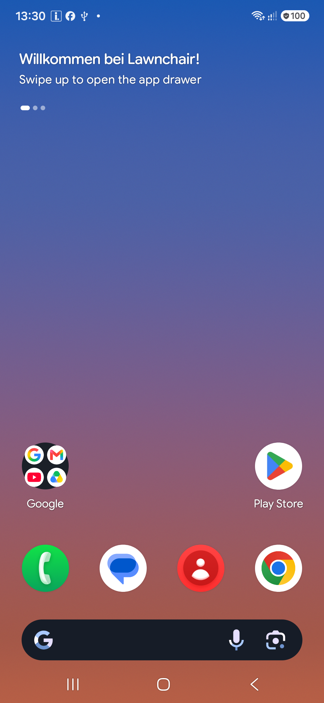

# Research: what to build on, and what the platform allows

Status: Phase 0 findings, 2 November 2026. Everything below was checked against the live
repositories or the connected devices; links are in the text.

## 1. The short version

- **Launcher3 is the right reference, but not the right build.** AOSP Launcher3 is a system
  app built with Soong inside the AOSP tree; it has no standalone Gradle build.
- **Lawnchair 16 is the pragmatic base.** It is Launcher3 from Android 16, already builds with
  Gradle 9.8.2 / AGP 9.5, already targets **SDK 37**, and is Apache-2.0.
- **The feature is a known gap, not a solved one.** Lawnchair's own tracking issue for folder
  swipe-up ("cover mode") has been open since 2022. Nova called it *Swipe to open folder*;
  Action Launcher called it *Covers*. Both apps are effectively discontinued, so the audience
  that used it is unserved.
- **Samsung is the constraint that shapes the product.** Third-party launchers on One UI do not
  get the system's app-open animation, and One UI does not honour `GestureNavContract` for
  non-system launchers. We cannot fix that; we should design around it and say so honestly.

## 2. Candidate bases

| Project | Licence | Base / target | Build | Status | Fit |
|---|---|---|---|---|---|
| [AOSP Launcher3](https://android.googlesource.com/platform/packages/apps/Launcher3/) | Apache-2.0 | Android 17 (`main`) | Soong only, inside AOSP | Reference implementation | **Reference, not a fork candidate** |
| [Lawnchair 16](https://github.com/LawnchairLauncher/lawnchair) (`16-dev`) | Apache-2.0 | Launcher3 Android 16, `targetSdk 37`, `compileSdk 37.2`, `minSdk 26` | Gradle 9.8.2, AGP 9.5, JDK 21 | Very active (pushed 2026-11-02) | **Recommended base** |
| [Neo Launcher](https://github.com/NeoApplications/Neo-Launcher) | GPL-3.0 | Launcher3, A16 port in progress | Gradle, JDK 17/21 | Active, but slower | Good code reference; GPL is a product constraint |
| [Expressive Launcher](https://github.com/denson9874/ExpressiveLauncher) | Apache-2.0 (+ notices) | Lawnchair 16 fork, `minSdk 31`, `targetSdk 37` | Gradle, JDK 21, Android 37.1 SDK | One maintainer, 31 stars | Proof that a rebranded Lawnchair fork ships; useful build reference |
| [Launcher314](https://github.com/bearinmindcat/Launcher314) | GPL-3.0 | From scratch, Kotlin + Compose | Gradle | New (2026), 180 stars | Reference for a Compose-first workspace, not a base |
| [Launcher3 Gradle ports](https://github.com/siren-ocean/Launcher3) | Apache-2.0-ish | Launcher3, Android 11–14 | Android Studio | Stale | Historical only; `likkka/Launcher3` is a 2014 relic |

Why Lawnchair wins for this project:

1. **It is already at the target API.** `targetSdk = 37`, `compileSdk` 37.2, build-tools 37.0.0.
   There is no migration project between us and a working Android 17 launcher.
2. **It is Apache-2.0.** Confirmed in `LICENSE.txt` (AOSP + Lawnchair, Apache 2.0). No copyleft
   obligation on our additions; attribution only.
3. **It is a real Launcher3, not a lookalike.** Workspace, folders, widgets, icon packs, search,
   backup/restore, work profile, private space, predictive back and the Material 3 Expressive
   theme are already there. We are adding a feature, not rebuilding a launcher.
4. **The build is reproducible.** `./gradlew assembleLawnWithQuickstepGithubDebug` is the CI task;
   the repo ships its AOSP prebuilts and the SystemUI submodule.

Costs we accept:

- ~9,000 files and a large dependency graph; first build is slow.
- Lawnchair branding is spread across `res/`, `AndroidManifest.xml`, `build.gradle` flavours and
  the launcher component name. A rebrand is a deliberate work package (Phase 1).
- Upstream moves quickly (`16-dev` was pushed today). Our changes must live in a thin overlay so
  we can rebase monthly.

## 3. The feature already has a name and a paper trail

The requested behaviour is exactly what the community calls **cover mode**:

- [Lawnchair #2659 — "Re-implement cover mode (folder swipe-up gestures)"](https://github.com/LawnchairLauncher/lawnchair/issues/2659)
  is **open**, labelled `feature-request`, `tracking issue`, `status: reviewed`, assigned, with
  27 comments and 47 reactions. It was opened in May 2022, when Lawnchair dropped the feature
  present in Lawnchair 2.
- [Lawnchair #4651 — "Swipe up gesture on folder to open specific app"](https://github.com/LawnchairLauncher/lawnchair/issues/4651)
  was closed as a duplicate of #2659. Its comments describe the interaction precisely:
  - "In Nova I have setup where there first app in the folder can be opened with a tap, and the
    folder itself can be opened with swipe up."
  - "The N is not just an icon, if I swipe up on it, a folder opens up… This way I don't have
    multiple pages to scroll through… **Best case**: open my favourite app with a single tap.
    **Worst case**: open any other app with a swipe and a tap."
  - Action Launcher calls it **Covers** and draws "a small bubble at the bottom right" so users
    can tell a cover from a plain icon.
  - The gesture does **not** conflict with swipe-up-for-app-drawer because it is scoped to the
    icon under the finger.
- The Pixel Launcher Xposed module [Pixel Launcher Folders](https://github.com/doccstat/pixel-launcher-folder)
  shows the same appetite from the other direction: people root their phones to get folders in
  the drawer. Our feature is more valuable and needs no root.

**Conclusion:** we are not inventing demand; we are shipping an orphaned, well-understood
interaction in a maintained launcher. That is a strong positioning story for the store listing
and for the first-run tutorial.

**Update, 4 November 2026:** the interaction is no longer just a request. [PR #7213 "feat: Add
folder cover mode"](https://github.com/LawnchairLauncher/lawnchair/pull/7213) implements it in 12
files and is open against `16-dev`, mergeable, with 11 commits and review fixes already applied
(hotseat, dots, accessibility, icon refresh). `16-dev` does not contain it yet — I checked
`FolderInfo.java` on the branch for `FLAG_COVER_MODE`: absent. The fork therefore merges the PR
instead of writing a second implementation.

## 4. Is it technically cheap? Yes — this is the important finding

Launcher3 stores folders as rows in `favorites` with `itemType = ITEM_TYPE_FOLDER`. The folder's
metadata has a persisted **`options` bitmask**:

```java
// FolderInfo.java (AOSP main)
public static final int FLAG_ITEMS_SORTED       = 0x00000001;
public static final int FLAG_WORK_FOLDER        = 0x00000002;
public static final int FLAG_MULTI_PAGE_ANIMATION = 0x00000004;
public static final int FLAG_MANUAL_FOLDER_NAME = 0x00000008;

@Override
public void onAddToDatabase(@NonNull ContentWriter writer) {
    super.onAddToDatabase(writer);
    writer.put(LauncherSettings.Favorites.OPTIONS, options);
}
```

`options` is already written to `LauncherSettings.Favorites.OPTIONS` and read back by the loader.
Adding `FLAG_COVER = 0x00000010` needs **no database migration and no new table**. A folder's
first child is already ordered by rank, so "the first app is the face" is the natural model.

The icon itself is `FolderIcon` — a `FrameLayout` that draws a preview grid via
`PreviewItemManager` and gets its click listener from the activity:

```java
FolderIcon icon = (FolderIcon) inflater.inflate(resId, group, false);
icon.setOnClickListener(activity.getItemOnClickListener());
```

`FolderIcon.onTouchEvent` currently forwards to `super` and a long-press helper. A cover icon
needs three local changes:

1. Draw a single preview item (the face app) plus the stack affordance, instead of the 2×2 grid.
2. Replace the click listener for cover folders with "launch `contents.get(0)`".
3. Add a vertical-drag gesture that opens the existing `Folder` with a peek preview.

That is a contained change in `FolderIcon`, `ItemClickHandler`, `FolderInfo`, and the folder
settings UI. It does not require forking the workspace, the drag layer, or the database.

## 5. Platform reality on the target devices

Connected hardware, queried with `adb`:

| Device | Model | Android | API | Display |
|---|---|---|---|---|
| Galaxy A54 | SM-A546B | 16 | 36 | 1080×2340 @ 450 dpi (420 override) |
| Galaxy S (2026 FE) | SM-S741B | 17 | 37 | 1080×2340 @ 450 dpi (420 override) |

Both are 411 × 891 dp at the override density. That is the design target: a 5×5 grid with
comfortable 60 dp icons and a bottom search field within thumb reach.

**The owner's S741B is running Action Launcher as its default home app.** That is the launcher
that named this interaction *Covers* and is no longer developed. The A54 is on One UI Home. This
is the strongest possible validation of the product thesis: the first user is already paying the
switching cost and has the exact habit we are designing for.



*Lawnchair 16 debug, first run on the S741B: German system, 3-button nav, the stock welcome
screen, a single Google folder and the bottom search pill. This is the baseline the Alcove shell
has to replace.*

### What Android 17 (API 37) changes for us

From [Behaviour changes: apps targeting Android 17](https://developer.android.com/about/versions/17/behavior-changes-17):

- Large-screen (`sw >= 600dp`) apps can no longer opt out of orientation/resizability overrides.
  Irrelevant on these phones, relevant if we ever support tablets/foldables.
- `RemoteViews` for app widgets gets a hard memory ceiling (`6 × width × height` bytes). This
  applies to widget *providers*, not to the launcher host — but it matters the day we ship our
  own widget.
- Static final fields become unmodifiable, the `MessageQueue` implementation changes, and
  `setContentCaptureEnabled(false)` stops working (use `FLAG_SECURE`). Nothing here should touch
  Launcher3, but it is a good reason to run the full instrumented suite on API 37, not just 36.

From [Android 17 features](https://developer.android.com/about/versions/17/features):

- **Handoff** surfaces activities from a user's other devices "through various entry points, like
  the launcher and taskbar". This is a future differentiator for a launcher, not a Phase 1 item.
- Pixel Launcher is reportedly loosening its grid in Android 17 QPR1 (free placement of icons and
  widgets, blank space). Reported by Android Authority and relayed by
  [IT之家](https://www.ithome.com/0/947/666.htm); treat as a trend signal, not a spec.

### What Samsung changes for us

From [Android Authority's report on One UI and third-party launchers](https://www.androidauthority.com/third-party-launchers-one-ui-3527788/):

- The **app-open** animation is drawn by the system and is effectively reserved for the system
  launcher. A third-party launcher cannot reproduce it exactly.
- The **app-close** animation uses `GestureNavContract`; the Niagara developer reports that One UI
  does not honour it for third-party launchers.
- QuickSwitch (system recents for third-party launchers) requires root and, per
  [Lawnchair's docs](https://docs.lawnchair.app/integrations/quickswitch), is scoped to Android
  15–16. We should ship **without** QuickStep and rely on the system recents.

Product consequence: our motion budget goes into **our own surfaces** — the cover peek, the
folder card, the drawer — not into pretending we can own system transitions. That is also where
a distinctive launcher can still win.

## 6. Build feasibility on this machine

The fork now builds from the repo root (upstream `16-dev` + PR #7213):

- Lawnchair expects **JDK 21**, **Gradle 9.8.2**, **AGP 9.5.0**, build-tools **37.0.0** and
  platform **android-37.2** (`compileSdk { release(37) { minorApiLevel = 2 } }`).
- `sdkmanager` **fails** to install `platforms;android-37.2` with `Failed to read or create
  install properties file` even though the SDK root is writable. It was installed manually from
  `platform-37.2_r02.zip` into `platforms\android-37.2`; the previous spike compiled against 37.0
  as a workaround.
- The JDK 21 copy in `calendar/.tools/jdk21` starts but **cannot create any file** (even in
  `%TEMP%`), while JDK 25 creates files normally. The build therefore runs with the installed
  Temurin **JDK 25**; Gradle 9.8.2 and AGP 9.5 accept it.
- Gradle's default home (`C:\Users\Robert\.gradle`) denied the wrapper's lock file to the JVM.
  The scripts set a repo-local `GRADLE_USER_HOME` and use the wrapper successfully.

Exact working command (see `docs/BUILD.md`):

```powershell
$env:JAVA_HOME = "C:\Program Files\Eclipse Adoptium\jdk-25.0.3.9-hotspot"
$env:ANDROID_HOME = "$env:LOCALAPPDATA\Android\Sdk"
.\scripts\build.ps1 -Install -Device RZGL81FQYEN
```

**Result:** `BUILD SUCCESSFUL in 6m 20s` (643 tasks). 49 MB debug APK, target API 37. On the S741B
(API 37): cold start 1.54 s, "Enable cover mode" popup works, tapping the cover launched Google
Search, swiping up opened the folder (Gmail, YouTube, Drive). The A54 (API 36) has not been re-run
with the fork. Full log, artefact and gotchas: [BUILD.md](BUILD.md).

## 7. Open questions for the user

1. **Licence intent.** Apache-2.0 lets us keep modifications closed. GPL (Neo) would force
   publication. Recommendation: stay Apache.
2. **Product or personal?** If personal, we can strip Play Store concerns and iterate faster.
   If product, naming/trademark and a privacy policy become Phase 1 blockers.
3. **Brand.** Shortlist in `docs/DESIGN.md`; the working name in this repo is **Alcove**.
4. **How much Lawnchair do we keep?** Recommendation: keep the engine, replace the shell
   (home layout, settings IA, onboarding, icon, name) and keep upstream features behind a
   "Lawnchair extras" settings group we can trim later.
